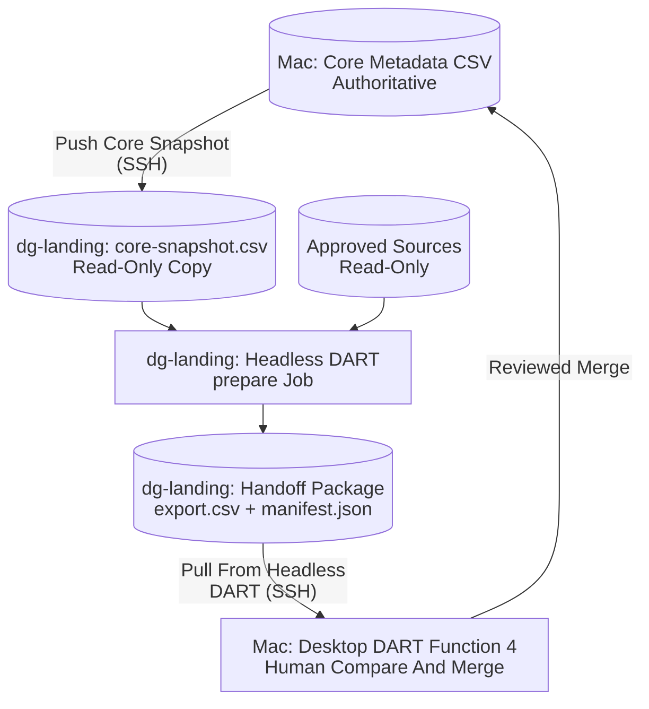

# DART on Linux: Headless Operating Overview

**Headless DART prepares data on dg-landing. Desktop DART reviews and merges.**

Headless DART on `dg-landing` has no browser or web interface. It analyzes
approved server sources, assigns durable IDs, exports CSV metadata, optionally
generates derivatives and backfills GEMS metadata, and then leaves a
checksummed **handoff package**. Desktop DART on your Mac pulls that package
over SSH, and you make every compare/merge decision in
[Function 4](FUNCTION_4_COMPARE_MERGE_CSV.md) against the authoritative core
metadata CSV, which stays on the desktop.

Headless DART **never compares, merges, or writes a core metadata CSV**.

This is everyday operation **after approved installation and storage setup**.
For setup, use [Headless Linux Installation](INSTALL-LINUX.md).
For isolated checks, use [Acceptance Testing](LINUX-ACCEPTANCE.md).
For a small GEMS-complete collection, use the
[Collection-Agnostic GEMS-to-DART Runbook](GEMS-HEADLESS-PILOT.md), including copy/paste
commands for a no-upload rehearsal and a separately approved publishing run.

<style>
@media print {
  .dart-diagram {
    break-before: page;
    page-break-before: always;
    break-inside: avoid;
    page-break-inside: avoid;
  }
  .dart-diagram svg {
    display: block;
    max-width: 100% !important;
    max-height: 6in !important;
    width: auto !important;
    height: auto !important;
  }
}
</style>

<div class="dart-diagram">

## Division of Work



</div>

The core snapshot gives headless DART the collection's column schema and
existing object IDs. It is a read-only input; headless DART never edits it.

## Desktop Prerequisites

Desktop DART reaches `dg-landing` with the system `ssh` command in batch mode,
so **key-based SSH authentication is required**. Password or interactive
prompts fail instead of hanging. Confirm from a Mac terminal:

```bash
ssh -o BatchMode=yes sysadmin@dg-landing true
```

In desktop **Function 0**, under **Headless DART Handoff**, set:

| Setting | Example | Meaning |
| --- | --- | --- |
| `headless_host` | `sysadmin@dg-landing` | SSH target running headless DART |
| `headless_project_dir` | `/data/dart/data/projects/REPLACE-COLLECTION` | Absolute managed project directory on that host |

Both are optional and per desktop project. Leave both blank to turn the
handoff buttons off. Desktop DART validates them before saving and never
accepts SSH options in either field.

## One-Time Project Setup

1. **On Linux**, an operator creates the private project directory:

   ```bash
   umask 077
   mkdir -m 700 /data/dart/data/projects/REPLACE-COLLECTION
   ```

2. **On the Mac**, in desktop Function 4, click **Push Core Snapshot**. This
   copies the configured core metadata CSV to
   `REPLACE-COLLECTION/core-snapshot.csv` (owner-only) on `dg-landing`. The
   desktop core is not changed.

3. **On Linux**, save the collection's headless settings from an owner-only
   JSON file. `core_metadata_csv` must point to the pushed snapshot:

   ```json
   {
     "working_dir": "/data/dart/data/projects/REPLACE-COLLECTION",
     "input_dir": "/APPROVED/LINUX/SOURCE",
     "collection-id": "replace-collection",
     "core_metadata_csv": "/data/dart/data/projects/REPLACE-COLLECTION/core-snapshot.csv",
     "gems_metadata_csv": "",
     "azure_blob_storage_path": "",
     "group_compound_objects": true,
     "create_multiple_objects": false,
     "process_OHM_data": false
   }
   ```

   ```bash
   chmod 600 /data/dart/config/settings-REPLACE-COLLECTION.json
   cd ~/GitHub/DART
   .venv/bin/python -m dart_linux --env-file /data/dart/config/dart.env \
     --configure --inputs /data/dart/config/settings-REPLACE-COLLECTION.json
   ```

Use the **same `collection-id`** as the desktop project. Once a project has
durable IDs, headless DART refuses to change its collection ID. Set
`gems_metadata_csv` to an approved readable GEMS CSV path to enable server-side
GEMS backfill. Source paths must be actual Linux mount paths; Mac volume names
are never translated.

Push a fresh core snapshot whenever the desktop core changes materially,
especially after a merge, so new jobs reuse the latest IDs.

## Everyday Flow

### 1. Prepare a Package on Linux

Put job inputs in an owner-only JSON file:

```json
{
  "working_dir": "/data/dart/data/projects/REPLACE-COLLECTION",
  "input_dir": "/APPROVED/LINUX/SOURCE",
  "allow_uploads": false,
  "overwrite": false
}
```

```bash
chmod 600 /data/dart/config/job-inputs.json
cd ~/GitHub/DART
.venv/bin/python -m dart_linux --env-file /data/dart/config/dart.env \
  --job prepare --inputs /data/dart/config/job-inputs.json
```

`prepare` runs export, then derivatives, then handoff, as one job. Optional
input keys:

| Key | Default | Effect |
| --- | --- | --- |
| `derivatives` | `true` | Generate derivatives before packaging |
| `backfill` | `true` when the project has `gems_metadata_csv` | Fill blank export fields from GEMS metadata on the server |
| `allow_uploads` | `false` | Permit Azure uploads for this job only |
| `overwrite` | `false` | Permit replacing existing blobs; requires `allow_uploads` |

No credentials belong in inputs. Azure credentials come only from the private
environment file, and containers must already exist.

The CLI prints the job ID, evidence path, and the final job record, including
the package path, row count, ID-conflict count, and warnings. Exit 0 means
`succeeded`; nonzero means failure, cancellation, or startup rejection.
Ctrl+C or SIGTERM requests cooperative cancellation.

### Overnight Collection Batches

Use `--batch` instead of `--job prepare` to process multiple collections
**sequentially**, then review/merge their packages individually the next day.
The batch holds the existing single-writer locks for its entire lifetime;
do not run configuration or other headless jobs concurrently.

Create an owner-only queue JSON on Linux, for example
`/data/dart/config/overnight.json`:

```json
{
  "collections": [
    {
      "collection_id": "new-collection",
      "input_dir": "/APPROVED/GEMS/new-collection/objects",
      "setup": {
        "core_template": "/data/dart/config/new-collection-template.csv",
        "gems_metadata_csv": "/APPROVED/GEMS/new-collection/collection_metadata.csv",
        "azure_blob_storage_path": "/objs/new-collection",
        "group_compound_objects": true,
        "create_multiple_objects": false,
        "process_OHM_data": false
      },
      "allow_uploads": false,
      "overwrite": false
    },
    {
      "collection_id": "configured-collection",
      "input_dir": "/APPROVED/GEMS/configured-collection/objects",
      "allow_uploads": false
    }
  ]
}
```

Replace all example collection IDs and paths. The queue's `input_dir` is the
GEMS run's **`objects/` directory**, not the run directory. Each ID must occur
only once per queue and must not be the reserved `collection-template` slug.
Unknown keys and non-boolean flags are rejected before any project setup.
No credentials belong in the queue.

**Automatic setup is only for genuinely new collections.** Stage an approved
**header-only** CollectionBuilder CSV under the private configuration root
(or managed `projects` root) and `chmod 600` it. The batch creates
`/data/dart/data/projects/<collection_id>`, copies that template to
`core-snapshot.csv`, and saves settings using the existing configuration
validator. It does not create an authoritative Mac core or a CollectionBuilder
site. A template containing data rows is rejected. For existing collections,
configure the project and push the real snapshot normally, then omit `setup`.

Setup defaults to flat compounds (`group_compound_objects=true`,
`create_multiple_objects=false`, `process_OHM_data=false`); GEMS and Azure
paths default to blank. The same setup entry can be retried: matching saved
settings are reused, **not rewritten**, and even a subsequently refreshed
snapshot is left unchanged. Differing saved settings cause that collection to
fail; inspect the project rather than deleting it or its ID map. Partial setup
without settings reuses a snapshot only if its bytes match the template.
Never use automatic setup to migrate an existing desktop project's mappings.

Each entry accepts the normal prepare options: `derivatives`, `backfill`,
`allow_uploads`, and `overwrite`, with the same defaults and validation.
Uploads default to **off for each collection independently**. Set
`allow_uploads=true` only after that collection has passed the existing
no-upload rehearsal and desktop review gate and publishing has been approved.
`overwrite=true` additionally requires upload approval. Batch mode does not
bypass those gates or create Azure containers. A new collection's first
overnight run should therefore be a no-upload rehearsal; a later approved
publishing queue can reuse the same projects and IDs.

For a foreground test **at a Linux shell prompt**:

```bash
chmod 600 /data/dart/config/overnight.json
cd ~/GitHub/DART
.venv/bin/python -m dart_linux --env-file /data/dart/config/dart.env \
  --batch --inputs /data/dart/config/overnight.json
```

Unlike the foreground single-collection runbook, an overnight launch must
survive SSH disconnects. On `dg-landing`, use an approved **system service**,
running as the DART storage owner, not a foreground SSH command. For example,
an administrator can launch this transient systemd service **on Linux**
(adjust the account and checkout paths to the installed values):

```bash
sudo systemd-run --unit=dart-overnight-20261029 \
  --uid=sysadmin --gid=sysadmin \
  --working-directory=/home/sysadmin/GitHub/DART \
  --property=UMask=0077 \
  --property=TimeoutStopSec=infinity \
  /home/sysadmin/GitHub/DART/.venv/bin/python -m dart_linux \
  --env-file /data/dart/config/dart.env \
  --batch --inputs /data/dart/config/overnight.json

sudo systemctl status dart-overnight-20261029 --no-pager
sudo journalctl -u dart-overnight-20261029 -n 40 --no-pager
```

Use a unique unit name per launch. Service creation requires the administrator's
approval; these commands do not install a recurring schedule. `systemd-run`
returning successfully means **launched**, not **completed**: confirm status
and a `Batch:`/`Summary:` line in the journal before disconnecting. A fast run
may already have finished; check its exit status and summary instead. Once
launched and verified, the system service continues with the Mac disconnected
or asleep. Do not edit the selected environment file, queue, templates,
sources, or settings during a run. The queue is read once and an evidence copy
is saved, but source/template files are read as each collection starts.

The batch prints and atomically updates a private
`/data/dart/data/batches/<batch-id>/summary.json`, with a copy of the input
queue alongside it. Each collection record includes its state, project path,
job ID, log path, and normal prepare result (package path, row count,
ID conflicts, and warnings). Normal per-job evidence remains under `jobs`.
Read the summary at the exact printed path; `--list-jobs` also lists the
individual prepare jobs.

- A collection setup/submission/processing failure is recorded and later
  collections still run. Storage or evidence-persistence failure stops the
  batch instead of claiming success.
- Exit `0` / batch `succeeded` means every entry succeeded. Exit `1` / batch
  `failed` means at least one failed. Successful packages remain available.
- To stop, use `sudo systemctl stop dart-overnight-20261029`. SIGTERM requests
  cooperative cancellation and prevents subsequent submissions; exit `130`
  / batch `cancelled` leaves unstarted entries `pending`. Stopping can take
  time while the current file/network operation finishes.
- Power loss or forced termination may leave the summary `running`. This is
  not proof that a process is alive or that packages completed. Verify the
  service and job evidence. As with individual jobs, there is **no automatic
  resume**; active job records become `interrupted` on the next service open.
  Build a new queue containing only failed, interrupted, or pending
  collections after inspecting partial outputs. Rerunning the entire queue
  runs successful entries again too, preserving their IDs but creating new
  jobs/packages.

The next day, work through successful summary entries using the desktop steps
below. For automatically created Linux projects, first establish the matching
Mac core from the same header-only schema using SHOW's Mac-side initializer:

```bash
# Run at the local Mac prompt, not on dg-landing. Preview first.
ruby "$HOME/GitHub/SHOW/scripts/initialize_collection.rb" \
  --slug REPLACE-COLLECTION --metadata-name REPLACE-COLLECTION_metadata
# After reviewing the planned files and catalog cell changes:
ruby "$HOME/GitHub/SHOW/scripts/initialize_collection.rb" \
  --slug REPLACE-COLLECTION --metadata-name REPLACE-COLLECTION_metadata --apply
```

This creates the CSV and populated `_config.yml`/`Collection_Notes.md` together,
and records pending review/merge in SHOW's collection catalog without
publishing. Existing files are preserved. It uses the catalog's existing
title; supply `--title 'Actual Collection Title'` in both commands when adding
a missing row. New catalog rows default to draft, with search disabled.
To initialize **all catalog collections with no existing SHOW directory** in
one Mac-side step, use `--all` instead of `--slug`/`--metadata-name`: preview
with `ruby "$HOME/GitHub/SHOW/scripts/initialize_collection.rb" --all`, then
repeat with `--apply`. Bulk mode uses `<slug>_metadata.csv` and skips existing
collection directories entirely, including incomplete ones. DART does not
invoke this automatically; Linux project setup and job submission remain
separate.
See [Establish the Authoritative Mac Core](GEMS-HEADLESS-PILOT.md#2-establish-the-authoritative-mac-core)
for safeguards and existing-collection handling. Verify that SHOW's template
header matches the staged Linux schema before proceeding.

Then configure Function 0 with the same collection ID and Linux project path.
Pull the **exact job ID** from the summary.
Local-only rehearsal packages are for review, not final publishing;
after approval, run the publishing queue and pull its packages for merge.
Review ID conflicts and warnings even when a job succeeded. After each merge,
push a fresh core snapshot before preparing more updates to that collection.
All authoritative core writes and merge decisions remain on the Mac.

### 2. Pull and Review on the Mac

1. Open desktop DART on the matching project and click **Function 4**.
2. Click **Pull From Headless DART...**. The dialog lists complete packages
   on `dg-landing` with their row counts and warnings.
3. Pull the intended package. DART verifies its checksum and collection ID,
   then saves it as `DART_export_handoff_JOB-ID.csv` (with its manifest as
   `DART_handoff_JOB-ID_manifest.json`) in `.DART-working-directory`.
4. The pulled CSV is now the newest export. Compare, review, and merge exactly
   as in any other Function 4 session.

If the desktop core changed since the snapshot was pushed, the pull warns you
before review. If no local `DART_export_*.csv` exists, Function 4 opens the
pull dialog automatically when headless handoff is configured.

## Individual Job Kinds

`prepare` is the normal path. The individual stages remain available:

| Job | Required Inputs | Result |
| --- | --- | --- |
| `analyze` | `working_dir`, `input_dir` | Saves durable file/compound ID mappings |
| `export` | `working_dir`, `input_dir` | `DART_export_JOB-ID.csv` in the project working directory |
| `derivatives` | `working_dir`, `csv_path` | Local or uploaded derivatives and an updated CSV |
| `handoff` | `working_dir`, `csv_path` | Handoff package from an existing managed CSV |
| `prepare` | `working_dir`, `input_dir` | Export, optional derivatives, and handoff |

Review job history at any time:

```bash
.venv/bin/python -m dart_linux --env-file /data/dart/config/dart.env --list-jobs
```

## Identifier Reuse

Headless export assigns object IDs in this order:

1. The project's saved `file_to_id_map` entry for the file
2. A `dg_<epoch>` identifier already present in the filename
3. The core snapshot's `objectid` for the same `original_file_name`, used only
   when that name is unique in both the snapshot and the scan
4. A newly generated `<collection-id>_dg_<epoch>` identifier

Compound parent IDs are not seeded from the snapshot. When an export row's
filename and ID disagree with the snapshot, the package lists it under
`id_conflicts` and adds a warning. Resolve these during desktop review; DART
never rewrites an existing core ID.

## Handoff Package Contents

Let `WORK` be the project directory and `JOB-ID` the job ID.

| Location | Contents |
| --- | --- |
| `WORK/handoff/JOB-ID/export.csv` | Prepared metadata, without the server-only `filepath` column |
| `WORK/handoff/JOB-ID/manifest.json` | Format, job ID, collection ID, CSV SHA-256, row count, snapshot SHA-256, ID conflicts, warnings |
| `WORK/handoff/JOB-ID/gems-backfill.json` | GEMS backfill statistics, when backfill ran |

`manifest.json` is written last, so a package without it is incomplete and is
never listed for pull. Packages are retained until an operator removes them;
no automatic cleanup runs.

**Derivatives are not transferred.** Without upload consent, derivative cells
contain local Linux paths. The manifest flags this as
`derivatives_local_only` with a warning. Those paths are not published URLs.
Authorize uploads for publishing-ready derivative URLs.

## Other Server Locations

| Location | Contents |
| --- | --- |
| `/data/dart/config/dart.env` | Private roots, approved source mounts, optional Azure credential |
| `/data/dart/config/.dart-service.lock` | Configuration writer lock |
| `/data/dart/data/.dart-service.lock` | Data writer lock |
| `/data/dart/data/jobs/JOB-ID/job.json` | State, timestamps, inputs, progress, result and artifact paths |
| `/data/dart/data/jobs/JOB-ID/job.log` | Redacted job activity/error log |
| `/data/dart/data/jobs/JOB-ID/settings-snapshot.json` | Effective settings and pre-job ID map, excluding credentials |
| `/data/dart/data/jobs/JOB-ID/analysis.json` | Analyzed file/compound records |
| `WORK/core-snapshot.csv` | Read-only core copy pushed by desktop DART |
| `WORK/.DART-working-directory/dart_settings.json` | Collection settings and durable ID map |
| `WORK/.DART-working-directory/DART_export_JOB-ID.csv` | Export CSV |
| `WORK/.DART-working-directory/derivatives_JOB-ID/` | Retained local derivatives and transient TIFF normalization |
| `WORK/.DART-working-directory/DART_export_with_derivatives_JOB-ID.csv` | Derivative metadata CSV |
| `WORK/_data/transcripts/` | OHM transcript copies, when applicable |

Headless DART never moves GEMS objects into `.complete`, never deletes
sources, and never publishes a CollectionBuilder site.

## Concurrency, Cancellation, and Recovery

Only one headless DART process may write the managed roots at a time. A second
writer is refused; inspect the existing process rather than deleting locks.
OS advisory locks release when the owner exits.

Cancellation is cooperative and occurs between checkpoints. If the final
atomic commit completed first, `succeeded` is correct. After a crash or
forced stop, the next start marks unfinished jobs `interrupted`, retains
evidence, and does not resume them. Review mappings and partial outputs
before submitting a replacement.

## Troubleshooting

| Symptom | Action |
| --- | --- |
| Desktop pull or push reports an SSH error | Confirm `ssh -o BatchMode=yes HOST true` succeeds from the Mac; install a key if needed |
| No packages listed | Confirm the `prepare`/`handoff` job succeeded and `headless_project_dir` matches the server project |
| Pull refuses a collection mismatch | The package's collection ID differs from the desktop project's `collection-id`; pull from the right project |
| Pull refuses to overwrite a local file | A different file already uses that name; review and remove it deliberately |
| Core snapshot differs warning | Push a fresh snapshot and re-run `prepare`, or review carefully knowing IDs may be stale |
| `id_conflicts` in the manifest | Review those rows during Function 4; existing core IDs are never changed |
| Local paths in derivative cells | That was local-only processing; authorize uploads only after approval |
| Another writer error | Wait for or inspect the existing headless process |
| Missing storage marker or changed identity | Stop; ask the administrator to verify storage; never initialize a fallback |
| Mac/UNC source path rejected | Use the approved Linux mount path; DART does not translate paths |
| Azure error | Review the redacted job log and private configuration; do not paste secrets |
