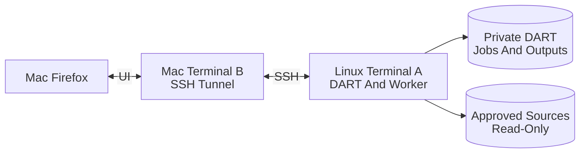

# DART On Linux: Operating Overview

**DART runs on dg-landing. Firefox runs on your Mac.**

This is everyday operation **after approved installation and storage setup**.
For setup, use [Private Linux Browser Installation](INSTALL-LINUX.md).
For isolated checks, use [Acceptance Testing](LINUX-ACCEPTANCE.md).

## The Three Terminals

| Piece | Computer | Purpose | Keep Open? |
| --- | --- | --- | --- |
| Terminal A | dg-landing | Runs the foreground DART process and its job worker | Yes, while any job is running |
| Terminal B | Local Mac | Runs the SSH tunnel | While using Firefox |
| Terminal C | dg-landing, optional | Inspects files or runs finite acceptance tests | Only as needed |
| Firefox | Mac | Submits jobs, reviews results, requests cancellation | Tab closure does not stop jobs |

The worker is **inside Terminal A's process**. It is not a fourth terminal or
a browser task. Closing Terminal A or losing its SSH session can stop DART;
tab independence is not process independence. A persistent service would
require separate approval.

<style>
@media print {
  .dart-diagram {
    break-before: page;
    page-break-before: always;
    break-inside: avoid;
    page-break-inside: avoid;
  }
  .dart-diagram svg {
    display: block;
    max-width: 100% !important;
    max-height: 6in !important;
    width: auto !important;
    height: auto !important;
  }
}
</style>

<div class="dart-diagram">

## Browser Connection And Job Ownership



</div>

The diagram uses wide horizontal flow, short labels, and a hard print-page
break. Do not replace these with narrow HTML labels. The Markdown PDF check
in the acceptance guide is still required for the installed renderer.

## Terminal A: Start DART On Linux

Connect to the host if this is not already a Linux terminal:

```bash
ssh sysadmin@dg-landing
```

Then, **on Linux**:

```bash
cd ~/GitHub/DART
umask 077
.venv/bin/python -m dart_linux \
  --env-file /data/dart/config/dart.env --web --port 8560
```

Leave this terminal occupied. It does not start GEMS or contact Azure.
It uses only the selected private environment file and binds only loopback.
Missing or unavailable managed storage is an error, not a request to create
a replacement home-directory tree.

## Terminal B: Start The Tunnel On Your Mac

Open a different **local Mac terminal**, not a Remote - SSH terminal:

```bash
ssh -N -o ExitOnForwardFailure=yes \
  -L 8560:127.0.0.1:8560 sysadmin@dg-landing
```

Leave it occupied; no shell prompt or output is normal. This transports UI
traffic and does not launch DART. A port conflict may mean a tunnel already
exists. Inspect it rather than starting duplicates or killing unrelated
processes.

## Firefox: Open DART On Your Mac

```text
http://127.0.0.1:8560
```

The URL's loopback address is your **Mac**. The tunnel forwards it to the
Linux listener's loopback address. Confirm the UI displays these roots:

```text
/data/dart/config
```

```text
/data/dart/data
```

Stop if the displayed roots differ. Copy paths from the selectable text or
read-only result fields; editable server-path fields support normal copy/paste.
No field opens your Mac's Finder, uploads a source tree, or converts a Mac
volume name into a Linux path.

## Collection Settings And Reusable Defaults

1. Enter the existing private **Working Project** directory under DART's
   `projects` directory.
2. For an existing project, click **Load This Project's Settings** before
   changing anything.
3. Enter the approved server source directory, stable collection ID, and that
   collection's own core CSV. Optionally enter a readable GEMS metadata CSV
   and an approved existing Azure container/path.
4. Set compound grouping, nested multiple objects, and OHM processing.
5. Click **Validate And Save Project Settings**. Errors appear beside that
   action. Changed project fields must be saved before submitting a job.

Example working directory shape:

```text
/data/dart/data/projects/REPLACE-COLLECTION
```

The **Remember Only These Three Checkboxes** option saves grouping, multiple,
and OHM booleans as defaults for a new form. Collection IDs, core CSVs, source
paths, Azure destinations, comparison selections, credentials, upload consent,
and merge consent are **not global defaults**. Existing project settings take
precedence when explicitly loaded.

Once IDs exist, the managed UI refuses to change that project's collection
ID. Neither old mappings nor archival paths are silently rewritten. Pause and
request a reviewed migration if moving an established Mac workflow.

## Job Flow

### Analyze And Save IDs

Click **Analyze And Save IDs**. This explicitly saves the durable file and
compound mappings. It reads sources but does not copy originals, upload,
merge, or retire anything. Inspect the job's analysis result before proceeding.

### Export CSV

Click **Export CSV**. It reuses saved identifiers and the core's column
structure. No Azure call occurs unless **Authorize Azure Uploads For This
Next Job** is checked. Replacing existing blobs also requires the separate
overwrite checkbox. Both reset after submission.

Credentials come only from the private environment file, never the form.
Azure containers must already exist. Failure is a failed job, not a
successful local-only fallback. IDs committed before the failure are retained
for a controlled retry.

In OHM mode, transcript CSVs are copied into this project's `_data/transcripts`
directory; sibling originals remain in their source tree. Auxiliary uploads
also require the same explicit upload authorization.

### Generate Derivatives

Select the successful export in **Persisted Job History**, then click
**Use Selected Job's CSV And Project**. Confirm the explicit CSV path.
Click **Generate Derivatives**.

Without upload consent, derivatives are local only, and their CSV cells
contain local Linux paths. They are **not published URLs**. Do not treat that
CSV as a ready-to-publish collection. An approved upload-enabled derivative
job produces Azure URLs. Images are bounded by 800 by 800 pixels and
thumbnails by 400 by 400 pixels; small originals are not enlarged.

Partial and completed local derivatives are retained for review, including
after cancellation or interruption.

### Compare, Review, And Merge

1. Select the intended successful CSV result explicitly.
2. Check GEMS backfill only if that project's GEMS metadata CSV is configured
   and approved for reading.
3. Click **Compare CSV With Core**. This writes snapshots and a comparison;
   it does not update the core.
4. Select the successful comparison job and click **Load Selected Comparison
   For Review**.
5. Review additions and individual field changes. Titles and replacements
   with empty values are unchecked by default. IDs are protected.
6. Check the explicit confirmation, then **Merge Reviewed Selections**.

Missing-in-new records remain in the core. Ambiguous filename keys are
rejected, not guessed. A changed core checksum invalidates the comparison;
compare again. The reserved `collection-template.csv` can provide a schema
but can never be a merge destination.

The managed workflow never moves GEMS objects into `.complete`, never deletes
sources, and never publishes a CollectionBuilder site.

## History, Progress, And Cancellation

Every job has a stable history entry and a browser route:

```text
http://127.0.0.1:8560/#/jobs/JOB-ID
```

Copy the address from Firefox after selecting a job. History also remains
available from the dropdown if your browser uses a different Flet route
presentation.

The UI polls approximately once per second. Progress reports scan/ID counts,
per-file processing, and upload byte counts. Some parsing, image rendering,
or network operations complete between checkpoints, so cancellation is not
instantaneous.

Click **Cancel Active Job**, then wait for `cancelled`. If the final atomic
commit already completed before cancellation arrived, `succeeded` is correct.
Review retained partial outputs before resubmitting. Never infer success just
because a file exists.

Only one tab owns write controls at a time. Other tabs are read-only. Closing
the operator tab releases its lease; a replacement can inspect or cancel the
ongoing job without starting another worker.

## Exact Output Locations

Let `WORK` be the selected working project and `JOB-ID` the displayed ID.

| Location | Contents |
| --- | --- |
| `/data/dart/config/dart.env` | Private roots, approved source mounts, optional Azure credential |
| `/data/dart/config/browser-defaults.json` | Reusable boolean defaults only |
| `/data/dart/config/.dart-service.lock` | Configuration writer lock |
| `/data/dart/data/.dart-service.lock` | Data writer lock |
| `/data/dart/data/jobs/JOB-ID/job.json` | State, timestamps, inputs, progress, result and log paths |
| `/data/dart/data/jobs/JOB-ID/job.log` | Redacted job activity/error log |
| `/data/dart/data/jobs/JOB-ID/settings-snapshot.json` | Effective collection settings and pre-job ID map, excluding credentials |
| `/data/dart/data/jobs/JOB-ID/analysis.json` | Analyzed file/compound records |
| `/data/dart/data/jobs/JOB-ID/comparison.json` | Reviewed comparison plan and core checksum |
| `/data/dart/data/jobs/JOB-ID/core-snapshot.csv` | Comparison's core snapshot without internal filepath |
| `/data/dart/data/jobs/JOB-ID/export-snapshot.csv` | Compared export, optionally GEMS-backfilled |
| `/data/dart/data/jobs/JOB-ID/gems-backfill.json` | Backfill statistics, when requested |
| `WORK/.DART-working-directory/dart_settings.json` | Collection settings and durable ID map |
| `WORK/.DART-working-directory/web-form.json` | This collection's remembered source path |
| `WORK/.DART-working-directory/DART_export_JOB-ID.csv` | Export CSV |
| `WORK/.DART-working-directory/derivatives_JOB-ID/` | Retained local derivative JPEGs and transient TIFF normalization |
| `WORK/.DART-working-directory/DART_export_with_derivatives_JOB-ID.csv` | Derivative metadata CSV |
| `WORK/.DART-working-directory/CORE-NAME.csv.backup_JOB-ID` | Pre-merge core backup |
| `WORK/_data/transcripts/` | OHM transcript copies, when applicable |
| Configured core CSV | Authoritative metadata updated only by a confirmed merge |

Running/failed jobs record artifact paths as work proceeds. A listed planned
path does not prove a complete file; state and content must also be reviewed.
No retention cleanup runs automatically.

## Terminal C: Optional Inspection

These read-only commands belong on Linux. Replace the displayed job ID:

```bash
cd ~/GitHub/DART
.venv/bin/python -m json.tool /data/dart/data/jobs/JOB-ID/job.json
tail -n 60 /data/dart/data/jobs/JOB-ID/job.log
df -h /data
ss -ltn | grep ':8560 '
```

Expected listener:

```text
127.0.0.1:8560
```

Do not manually edit managed metadata/settings while the process owns them.
Locks coordinate DART managed processes; they cannot prevent an unrelated
shell tool from ignoring the protocol.

## Optional Managed Headless Jobs

Existing helper-script CLIs are unchanged. For the managed workflow, stop
the web process first: the CLI uses the **same writer locks** and must not run
beside it on the same roots.

Put explicit inputs in an owner-only JSON file, for example an approved
private file under the configuration root:

```json
{
  "working_dir": "/data/dart/data/projects/REPLACE-COLLECTION",
  "input_dir": "/APPROVED/LINUX/SOURCE",
  "allow_uploads": false,
  "overwrite": false
}
```

Use a previously configured project with a reviewed core/schema and stable
collection ID. Replace the example paths; the CLI does not configure or
translate them for you.

```bash
chmod 600 /data/dart/config/job-inputs.json
cd ~/GitHub/DART
.venv/bin/python -m dart_linux \
  --env-file /data/dart/config/dart.env \
  --job export --inputs /data/dart/config/job-inputs.json
```

Other kinds are `analyze`, `derivatives`, `compare`, and `merge`.
Derivative/comparison inputs use `csv_path`; comparison optionally accepts
`backfill`. Merge inputs require the persisted `comparison` path,
`confirm_merge: true`, `selected_added` integer indices, and `selected_fields`
arrays of `[changed-record-index, field-name]`. Review the comparison before
constructing these selections. Uploads always require `allow_uploads: true`;
overwrite also requires `overwrite: true`. No credentials belong in inputs.

The CLI prints the job ID/evidence path and final job record. Exit 0 means
`succeeded`; nonzero means failure/cancellation/startup rejection. Ctrl+C or
SIGTERM requests cooperative cancellation. Job history and logs remain
available when the web process is restarted.

## Shutdown And Restart

1. Prefer to finish or explicitly cancel the active job.
2. In Terminal A, press Ctrl+C and wait for DART to exit. Shutdown requests
   cooperative cancellation and waits for the current operation/checkpoint.
3. In Terminal B, press Ctrl+C to stop the tunnel.

Do not delete lock files. OS advisory locks release when the owner exits;
removing a live lock file can undermine writer exclusion.

After a crash or forced stop, restart only after storage and processes are
verified. DART marks unfinished jobs `interrupted`, retains evidence, and
does not resume them or label them successful. Review mappings, partial
outputs, and remote upload state before explicitly submitting a replacement.

## Troubleshooting

| Symptom | Action |
| --- | --- |
| Firefox cannot connect | Confirm Terminal A is running, then confirm the local Mac tunnel and port |
| Wrong roots displayed | Stop; correct the selected private environment file before proceeding |
| Another writer error | Inspect the existing process; do not delete locks or start another instance |
| Read-only tab | Close the other operator tab and wait for lease handoff |
| Validation error | Read the notice immediately below the relevant action |
| Missing storage marker or changed identity | Stop; ask the administrator to verify storage; never initialize a fallback |
| Mac/UNC source path rejected | Obtain the approved actual Linux mount path; do not translate it by guesswork |
| Local paths in derivative CSV | That was local-only processing, not publishing; authorize uploads only after approval |
| Azure error | Review redacted job log and private credential/path configuration; do not paste secrets |
| Comparison says core changed | Compare again; do not bypass the checksum |
| Cancel remains pending | Wait for the current operation; use administrator-supervised intervention if storage is stuck |
| HTTP startup fails despite `pip check` | Reinstall the declared web dependency set and rerun isolated acceptance |

The browser/service boundary and actual storage outages still require the
manual checks in [Acceptance Testing](LINUX-ACCEPTANCE.md).
